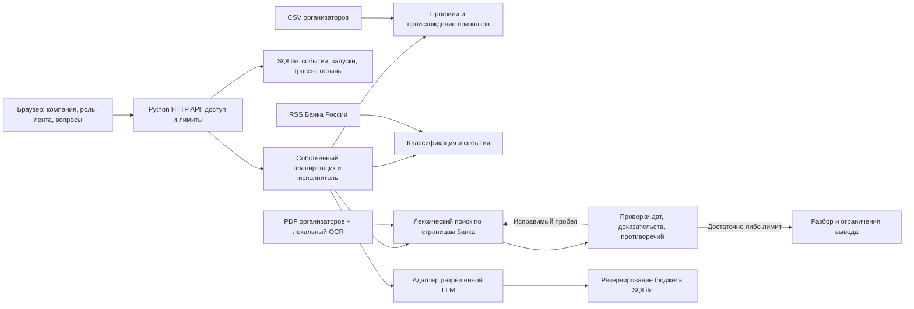

# Архитектура и эксплуатация

## Границы прототипа

Браузерный интерфейс Альфа-Бизнеса — демонстрационная оболочка. Он не подключён к реальным счетам, переводам, банковской авторизации и CRM. Данные организаторов обезличены. Демо-роли выбираются пользователем и не доказывают его полномочия в реальной компании.

## Исполнение

Один процесс Python с HTTP-потоками и SQLite WAL. Файлы профилей и корпуса загружаются локально. Клиентские изменения, новые новости, вопросы и роль поступают через API. Ранжирование и поиск детерминированы и объяснимы; дополнительные embedding-модели не используются. План и допустимые инструменты принадлежат коду проекта. Текст источника не может добавить инструмент или изменить полномочия.

В тестовом режиме интерпретации формируются правилами, явно маркируются и не являются ответами LLM. В живом режиме адаптер может вызвать только явно настроенный и подтверждённый API. Нет автоматической подмены недоступной модели тестовыми ответами. Текущий выбор пользователя — OpenRouter / google/gemma-4-26b-a4b-it:free. Ключ добавлен; один probe получил HTTP 429, поэтому APP_MODE=test сохранён. Бесплатный trial ограничен локальными квотами, стоимость без тарифов неизвестна.

## Безопасность

- По умолчанию сервер слушает только loopback. Без APP_TOKEN внешний bind запрещён. Bearer-токен и APP_COMPANY_SCOPE ограничивают доступ к профилям и сохранённым запускам на сервере. Это демонстрационный механизм, не production SSO/RBAC.
- Секрет LLM хранится только в серверном окружении. `.env` не исполняется как shell. Ключи не включаются в UI, trace или сообщения об ошибках провайдера.
- Внешний загрузчик получает только заранее разрешённый RSS Банка России. URL вручную добавленной новости хранится как ссылка, не запрашивается сервером. Произвольного HTTP-инструмента у агента нет.
- HTML источников удаляется перед обработкой; UI выводит тексты безопасно. Лимиты размеров тела, ответов, контекста и времени ограничивают нагрузку.
- Исходники и производные данные исключены из Git. HTTP не раздаёт весь рабочий каталог. PDF доступны только через ограниченный каталог источников.
- Бюджет резервируется транзакционно до внешнего запроса; при неопределённом результате запроса резерв сохраняется. Скользящие 24 часа выбраны консервативно, поскольку точная граница суток организаторами не дана.
- Бесплатный trial использует отдельный транзакционный резерв токенов и запросов (20 / 100000 за 24 часа). Ответы 402/429/401/403 и сетевые ошибки не вызывают автоматический повтор, оплату или смену модели. Подтверждённый usage записывается даже при некорректном JSON; неизвестный расход сохраняет резерв. Кэш разборов действует один час и зависит от модели, endpoint, данных и версии логики.
- 500 ₽ относятся к общему оплачиваемому ключу. Одно приложение не может видеть запросы из других инструментов команды: нужен единый шлюз/счётчик. Переменная подтверждения этого условия не заменяет реальную организацию работы.
- В трассе сохраняются вызовы, найденные материалы, проверки и ограничения. Скрытые рассуждения модели не запрашиваются и не сохраняются.
- Инструменты переводов, сделок, отправки сообщений, изменения прав и выполнения кода отсутствуют.

До банковской эксплуатации необходимы SSO, проверка должностных полномочий, изоляция tenant, ACL документов до поиска, TLS, шифрование хранилища и backups, ротация секретов, лимиты по пользователю/IP, audit retention и SIEM. Не считать эти механизмы реализованными банковскими интеграциями.

## Масштабирование

Для нового источника написать ограниченный адаптер к схеме события с датой, URL и происхождением; добавить тест парсинга, лимитов и дублей. Для отрасли расширить словарь факторов и экспертную выборку. Не менять агент на фиксированный сценарий для каждого заголовка.

При росте нагрузки вынести планировщик в очередь задач, хранение — в PostgreSQL, текстовый индекс — в поисковый движок, сохранив ID доказательств и ACL. Один централизованный ledger обязателен до запуска нескольких реплик с общим ключом. PDF и версии исходных данных хранить в закрытом объектном хранилище. Для маленького корпуса отдельная векторная БД не нужна.

## Сопровождение и мониторинг качества

Назначаемые роли: владелец данных отвечает за происхождение/даты и импорт, аналитик — за релевантность и корректность банковских тезисов, инженер — за ошибки API, задержку, бюджет и версии. Реальные ответственные пока не назначены.

Ежедневно после загрузки проверять количество новых событий, долю дублей, пропуски дат, ошибки парсинга и источники без обновления. На каждой версии прогонять технические тесты и фиксированный набор unseen/contradiction/stale примеров. Еженедельно аналитик оценивает слепую выборку минимум по признакам релевантности, причинной связи, опоры на источник и корректности позиции банка; объём определяется ресурсом команды, не задан кейсом.

Технические метрики API: задержка, доля утверждений с существующими ссылками, покрытие аналитикой банка, адаптивные запуски, запросы и бюджет, отзывы. Наличие ссылки не доказывает истинность или entailment. Экспертная precision@k, сравнение с отраслевым baseline и полезность для реального ЛПР требуют отдельной размеченной выборки; автоматические тесты их не заменяют.

При обновлении схемы SQLite требуется миграция с backup и проверкой восстановления. Для текущего прототипа резервная копия делается штатным SQLite backup API при остановке либо согласованном snapshot; нельзя копировать только основной файл активной WAL-базы. Тестовые runtime можно удалять только отдельно от исходных данных и после остановки сервера.

## Текущий AI-провайдер

Выбор пользователя 22.10.2026: OpenRouter / Gemma 4 26B A4B (free), точный ID google/gemma-4-26b-a4b-it:free. Прежние упоминания NVIDIA выше описывают предыдущую конфигурацию и сохранённую поддержку отдельного контракта. Для OpenRouter применяется тот же адаптер и учёт токенов; provider.allow_fallbacks=false, provider.max_price ограничен нулём. Платные Model ID и смешанные пары endpoint/model блокируются до сетевого вызова. APP_MODE=test сохраняется до проверки ключа.
